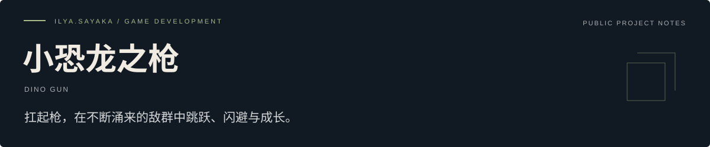
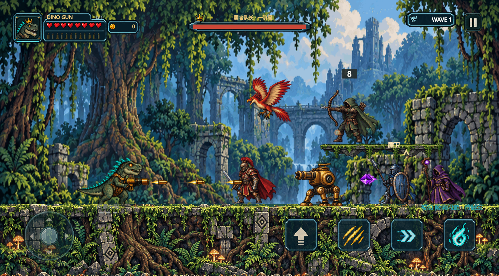

<!-- ilya-showcase:v1 -->

[游戏介绍](#游戏介绍) · [开发进度](./PROGRESS.md) · [画面说明](./MEDIA.md) · [开发者](https://github.com/YDZ-syj)

**像素风横屏动作射击**　/　可玩原型 · 真机验证准备

## 游戏介绍

一款面向微信小游戏的原创横屏动作射击游戏。玩家操控持枪恐龙，在连续战斗中走位、跳跃、近战与冲刺，击败敌人并选择强化，逐步形成自己的战斗风格。

## 想带来的体验

- 横屏平台移动与自动射击结合，让注意力回到走位和战斗时机。
- 战斗、升级选择与首领遭遇衔接，形成连续游玩的节奏。
- 不同角色、武器与强化带来不同的局内体验。
- 像素风场景、人物和界面构成统一的视觉方向。

## 开发画面

当前像素风战斗的桌面渲染预览。使用项目实际渲染器，不是微信手机实机截图。

## 当前进度

- 连续战斗、经验升级、强化选择与区域推进已形成可玩循环。
- 多角色、武器变化、近战、冲刺和首领战已接入原型。
- 当前像素风素材与主要界面已接入实际渲染器。
- 已有桌面渲染预览与本地回归记录。

**正在关注：** 继续打磨战斗可读性、触控操作与不同屏幕下的界面。 准备微信开发者工具及手机上的资源加载、性能和手感验收。

详细阶段记录见 [开发进度](./PROGRESS.md)。

## 后续与试玩

尚未将桌面预览等同于微信真机验证；当前不提供公开下载或上线日期。

可公开的试玩信息与重要进展会在本仓库更新。欢迎通过 [Issues](https://github.com/YDZ-syj/dino-gun-showcase/issues) 留下体验建议或交流意向。商务合作请勿在公开 Issue 中提交私人联系方式或保密材料。

---

**ilya.sayaka** · 游戏开发者 / 工作室筹备中  
本仓库用于介绍游戏与记录进度；游戏工程保持私有。  
最近整理：2026-10-18。
